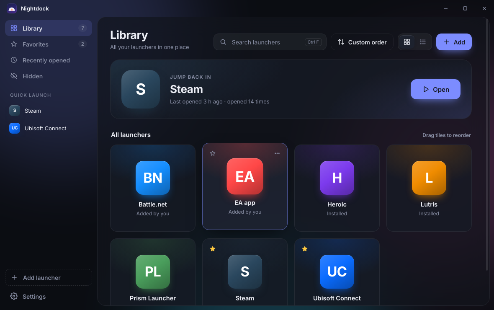
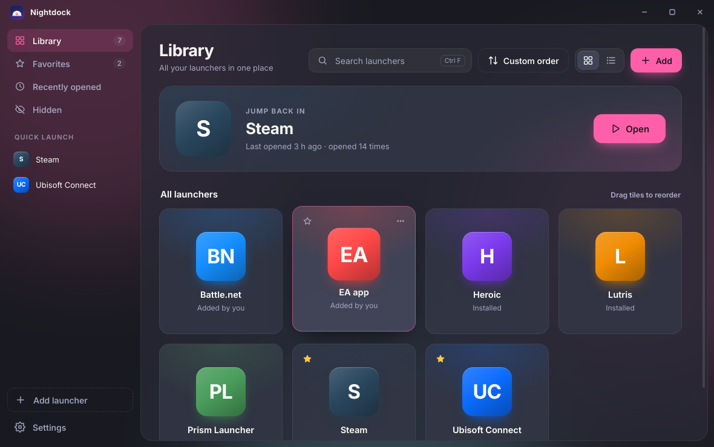

<p align="center">
  
</p>

<h1 align="center">Nightdock</h1>

<p align="center">
  <b>Every game launcher in one place.</b><br>
  Steam, Ubisoft Connect, Epic, EA app, Battle.net, Heroic, Lutris and more — one window, one click.
</p>

<p align="center">
  <a href="../../releases/latest"><b>Download</b></a> ·
  Windows 10/11 and Linux ·
  32 languages ·
  <a href="LICENSE">MIT license</a>
</p>

<p align="center">
  
</p>

## What it does

Tired of hunting for the right launcher? Nightdock finds the game launchers on your computer
and puts them on one screen. Click a tile and that launcher opens.

- **Finds your launchers by itself**
  - Windows: Steam, Ubisoft Connect, Epic Games, EA app, Battle.net, GOG Galaxy, Rockstar Games, Riot Client, Amazon Games, Prism Launcher
  - Linux: Steam, Heroic, Lutris, Bottles, Faugus, itch.io, Prism Launcher — including Flatpak versions, and Windows launchers you installed through Lutris
- **Add anything else** — a program, a command or a link like `steam://open/main`, with your own icon and colour
- **Fast to use** — type to search and press Enter, star favourites, drag tiles into your own order
- **Jump back in** — the launcher you used last waits at the top
- **Gets out of the way** — after opening a launcher it can stay open, minimize, hide in the tray or close
- **Make it yours** — 18 themes, any accent colour, a glow, plain or picture background, bigger or smaller tiles, grid or list view
- **Speaks your language** — 32 languages, picked automatically from your computer (and right-to-left for Arabic, Hebrew and Persian)

<p align="center">
  
  
</p>

## Download and install

Get the newest version from the [**Releases**](../../releases/latest) page.

| Your system | File | How |
|---|---|---|
| Windows 10/11 | `Nightdock-Setup-<version>.exe` | Run it. No administrator rights needed. |
| Windows, no install | `Nightdock-Portable-<version>-windows.zip` | Unzip and run `Nightdock.exe`. |
| CachyOS, Arch, Manjaro | `nightdock-<version>-x86_64.pkg.tar.xz` | `sudo pacman -U nightdock-*.pkg.tar.xz` |
| Ubuntu, Mint, Pop!_OS, Debian | `nightdock_<version>_amd64.deb` | Double-click it, or `sudo apt install ./nightdock_*.deb` |
| Fedora, openSUSE | `nightdock-<version>.x86_64.rpm` | Double-click it, or `sudo dnf install ./nightdock-*.rpm` |
| Any other Linux | `Nightdock-<version>-linux-x86_64.AppImage` | Make it executable and run it. If it won't start, run it with `--appimage-extract-and-run`. |

> **Windows says "Windows protected your PC"?** That happens because Nightdock isn't signed
> with a paid code-signing certificate yet. Click **More info → Run anyway**. You can check the
> code yourself — it's all in this repository.

Uninstall from Windows **Settings → Apps**. The uninstaller asks whether to keep your launchers
and settings.

## Languages

English, Norsk, Svenska, Dansk, Íslenska, Suomi, Deutsch, Nederlands, Français, Italiano,
Español, Português (Brasil), Polski, Čeština, Magyar, Română, Ελληνικά, Русский, Українська,
Türkçe, العربية, עברית, فارسی, हिन्दी, বাংলা, ไทย, Tiếng Việt, Bahasa Indonesia, 简体中文,
繁體中文, 日本語 and 한국어.

Nightdock uses your computer's language automatically. Change it in **Settings → Language**.

<p align="center"></p>

The translations were written with AI help. If you speak one of these languages and spot something odd, please [help fix it](CONTRIBUTING.md#translations) — it's one small file per language.

## Where your data is kept

Nightdock stores your launchers and settings only on your own computer:

- Windows: `%APPDATA%\Nightdock`
- Linux: `~/.config/Nightdock`

It doesn't collect data, track you or connect to the internet. The only network use is when
a launcher you open does so itself.

## Build it yourself

You need [Node.js](https://nodejs.org/) 20 or newer.

```bash
npm install
npm start            # run Nightdock from the source code
```

Making the installers (on Linux, or in WSL on Windows):

```bash
sudo apt install nsis rpm libarchive-tools    # Debian/Ubuntu; needed for the installers
npm run dist:win      # Windows installer + portable zip   → dist/
npm run dist:linux    # AppImage, .deb, .rpm, .pkg.tar.xz, .tar.gz → dist/
```

Pushing a tag like `v1.3.0` builds everything on GitHub and attaches the files to a release
(see [`.github/workflows/build.yml`](.github/workflows/build.yml)).

## Project layout

```
src/            the app's background code (window, finding and opening launchers)
renderer/       the interface: index.html, style.css, app.js
renderer/locales/  one translation file per language
build/          icon, Windows installer script and build helpers
docs/           screenshots for this page
```

## Contributing

Bug reports, ideas and translation fixes are very welcome — see [CONTRIBUTING.md](CONTRIBUTING.md).

## License

Nightdock is free and open source under the [MIT License](LICENSE).
It includes the Inter font (SIL Open Font License 1.1) and is built with Electron.
See [THIRD_PARTY_NOTICES.md](THIRD_PARTY_NOTICES.md) for the full list and trademark notes.

Nightdock isn't affiliated with Valve, Ubisoft, Epic Games, Electronic Arts, Blizzard or any
other company whose launcher it can open.
