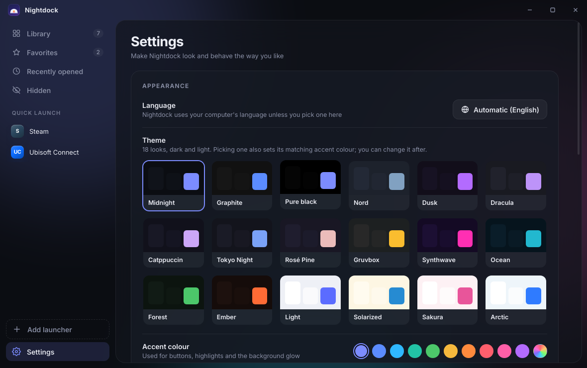
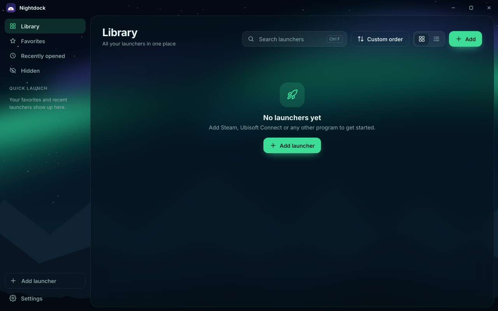
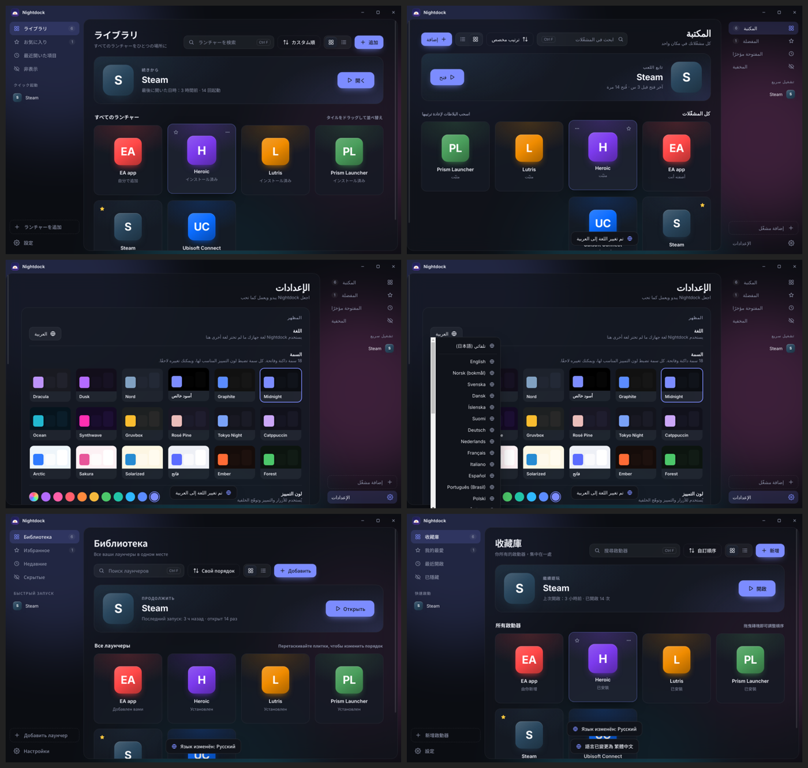

<p align="center">
  
</p>

<h1 align="center">Nightdock</h1>

<p align="center">
  <b>Every game launcher in one place.</b><br>
  Steam, Ubisoft Connect, Epic, EA app, Battle.net, Heroic, Lutris and more — one window, one click.
</p>

<p align="center">
  <a href="../../releases/latest"><b>Download</b></a> ·
  Windows 10/11 and Linux ·
  32 languages ·
  <a href="LICENSE">MIT license</a>
</p>

<p align="center">
  
</p>

## What it does

Tired of hunting for the right launcher? Nightdock finds the game launchers on your computer
and puts them on one screen. Click a tile and that launcher opens.

- **Finds your launchers by itself**
  - Windows: Steam, Ubisoft Connect, Epic Games, EA app, Battle.net, GOG Galaxy, Rockstar Games, Riot Client, Amazon Games, Prism Launcher
  - Linux: Steam, Heroic, Lutris, Bottles, Faugus, itch.io, Prism Launcher — including Flatpak versions, and Windows launchers you installed through Lutris
- **Add anything else** — a program, a command or a link like `steam://open/main`, with your own icon and colour
- **Fast to use** — type to search and press Enter, star favourites, drag tiles into your own order
- **Jump back in** — the launcher you used last waits at the top
- **Gets out of the way** — after opening a launcher it can stay open, minimize, hide in the tray or close
- **One-click updates** — an **Update now** button appears when a new version is out ([how it works](#updates))
- **Make it yours** — 26 themes (8 with their own matching wallpaper), any accent colour, a glow, plain, wallpaper or picture background, bigger or smaller tiles, grid or list view
- **Speaks your language** — 32 languages, picked automatically from your computer (and right-to-left for Arabic, Hebrew and Persian)

<p align="center">
  
  
</p>

## Download and install

### CachyOS, Arch, Manjaro — one pacman command

Open a terminal and paste:

```bash
curl -fLO https://github.com/LastJaegerVA/nightdock/releases/latest/download/nightdock-x86_64.pkg.tar.xz && sudo pacman -U nightdock-x86_64.pkg.tar.xz
```

It downloads the newest Nightdock package and installs it with pacman. Run the same command
again to update. Remove it with `sudo pacman -R nightdock`.

### Any Linux — one command

Open a terminal and paste:

```bash
curl -fsSL https://raw.githubusercontent.com/LastJaegerVA/nightdock/main/install.sh | bash
```

It downloads the newest release and installs the right package for your system
(pacman on Arch/CachyOS/Manjaro, apt on Debian/Ubuntu/Mint, dnf or zypper on Fedora/openSUSE,
or an AppImage anywhere else). It asks for your password to install. To remove Nightdock later:

```bash
curl -fsSL https://raw.githubusercontent.com/LastJaegerVA/nightdock/main/install.sh | bash -s -- --uninstall
```

### Windows

Download [**`Nightdock-Windows-Setup.exe`**](https://github.com/LastJaegerVA/nightdock/releases/latest/download/Nightdock-Windows-Setup.exe) (always the newest version) and run it.
No administrator rights needed. Prefer no install? Get [`Nightdock-Windows-Portable.zip`](https://github.com/LastJaegerVA/nightdock/releases/latest/download/Nightdock-Windows-Portable.zip),
unzip it and run `Nightdock.exe`.

On the [releases page](https://github.com/LastJaegerVA/nightdock/releases/latest), every file with **Windows** in its name is for
Windows; the rest are for Linux.

> **Windows says "Windows protected your PC"?** That happens because Nightdock isn't signed
> with a paid code-signing certificate yet. Click **More info → Run anyway**. You can check the
> code yourself — it's all in this repository.

Uninstall from Windows **Settings → Apps**. The uninstaller asks whether to keep your launchers
and settings.

### Linux — by hand

First download the file for your system from the [**latest release**](../../releases/latest),
then open a terminal in the folder you saved it to (usually `cd ~/Downloads`):

| Your system | File | Command |
|---|---|---|
| CachyOS, Arch, Manjaro | `nightdock-x86_64.pkg.tar.xz` | `sudo pacman -U ./nightdock-x86_64.pkg.tar.xz` |
| Ubuntu, Mint, Pop!_OS, Debian | `Nightdock-Linux-Ubuntu-Debian.deb` | `sudo apt install ./Nightdock-Linux-Ubuntu-Debian.deb` |
| Fedora, openSUSE | `Nightdock-Linux-Fedora.rpm` | `sudo dnf install ./Nightdock-Linux-Fedora.rpm` |
| Any other Linux | `Nightdock-Linux-x86_64.AppImage` | `chmod +x Nightdock-Linux-x86_64.AppImage && ./Nightdock-Linux-x86_64.AppImage` |

If the AppImage won't start, run it with `--appimage-extract-and-run` (your system is missing `libfuse2`).

## Languages

English, Norsk, Svenska, Dansk, Íslenska, Suomi, Deutsch, Nederlands, Français, Italiano,
Español, Português (Brasil), Polski, Čeština, Magyar, Română, Ελληνικά, Русский, Українська,
Türkçe, العربية, עברית, فارسی, हिन्दी, বাংলা, ไทย, Tiếng Việt, Bahasa Indonesia, 简体中文,
繁體中文, 日本語 and 한국어.

Nightdock uses your computer's language automatically. Change it in **Settings → Language**.

<p align="center"></p>

The translations were written with AI help. If you speak one of these languages and spot something odd, please [help fix it](CONTRIBUTING.md#translations) — it's one small file per language.

## Where your data is kept

Nightdock stores your launchers and settings only on your own computer:

- Windows: `%APPDATA%\Nightdock`
- Linux: `~/.config/Nightdock`

It doesn't collect data or track you. The only time Nightdock itself goes online is the
update check described below; anything else is a launcher you open doing so itself.

## Updates

When a new version is out, Nightdock shows an **Update now** button. One click downloads it,
installs it and restarts Nightdock. How it stays safe and honest:

- It only asks Nightdock's own GitHub page ([the latest release](https://github.com/LastJaegerVA/nightdock/releases/latest))
  whether there is a newer version. Nothing about you or your launchers is sent.
- It never installs anything until you press **Update now**.
- Every download is checked against the SHA-256 checksum GitHub publishes for that file. If it
  doesn't match, it is deleted and nothing is installed.
- It installs the same way you would by hand: the normal Windows installer, the same AppImage,
  or your Linux package manager, which shows its own password prompt (Nightdock never sees it).
- The portable Windows zip and the `.tar.gz` can't update themselves; they get a **Download** button instead.
- Don't want it? Turn off **Settings → Updates → Check for updates**.

All of it is in one readable file: [`src/updater.js`](src/updater.js).

## Build it yourself

You need [Node.js](https://nodejs.org/) 20 or newer.

```bash
npm install
npm start            # run Nightdock from the source code
```

Making the installers (on Linux, or in WSL on Windows):

```bash
sudo apt install nsis rpm libarchive-tools    # Debian/Ubuntu; needed for the installers
npm run dist:win      # Windows installer + portable zip   → dist/
npm run dist:linux    # AppImage, .deb, .rpm, .pkg.tar.xz, .tar.gz → dist/
```

Raising the version number in `package.json` and pushing to `main` builds everything on GitHub
and publishes a new release with all files automatically
(see [`.github/workflows/build.yml`](.github/workflows/build.yml)).

## Project layout

```
src/            the app's background code (window, finding and opening launchers)
renderer/       the interface: index.html, style.css, app.js
renderer/locales/  one translation file per language
build/          icon, Windows installer script and build helpers
docs/           screenshots for this page
```

## Contributing

Bug reports, ideas and translation fixes are very welcome — see [CONTRIBUTING.md](CONTRIBUTING.md).

## License

Copyright © 2026 Jonas Olsen-Sund ([LastJaegerVA](https://github.com/LastJaegerVA)). Nightdock is free and open source under the [MIT License](LICENSE):
anyone may use, change and share it, as long as they keep this copyright notice.
It includes the Inter font (SIL Open Font License 1.1) and is built with Electron.
See [THIRD_PARTY_NOTICES.md](THIRD_PARTY_NOTICES.md) for the full list and trademark notes.

Nightdock isn't affiliated with Valve, Ubisoft, Epic Games, Electronic Arts, Blizzard or any
other company whose launcher it can open.
